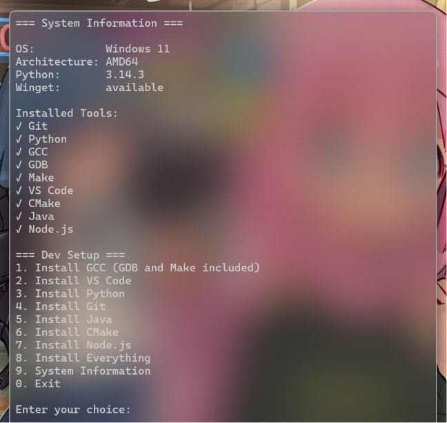

# Dev Setup

Automated setup tool for programming languages, compilers, and development environments.

The current application is a legacy interactive CLI. Development of a
GUI-independent Python core and a PySide6 desktop application is underway.
Validated domain models and platform detection now live in root-level `models/`
and `system/`; the desktop workflow is not implemented yet. See the
[architecture](docs/architecture.md), [migration roadmap](docs/migration.md),
and [development guide](docs/development.md). The current core record contract
is documented in [domain models](docs/domain-models.md).

The root-level `catalog/` now supplies reviewed metadata, strict JSON loading,
category browsing, and curated search. Run `python -m catalog validate` to check
the bundled catalog without installing software. See the
[catalog guide](docs/catalog.md) for its schema, platform scope, and source caveats.

The new core also includes the safe command runner and WinGet, Scoop, Homebrew,
and APT adapters. Their command previews, consent/elevation requirements, and
current limits are documented in the [package-manager guide](docs/package-managers.md).
They are not yet wired into the legacy CLI or a desktop installation workflow.

Linux adapter coverage now also includes pacman, DNF, zypper, apk and Flatpak.
The catalog contains 14 packages and 39 reviewed mappings. See the
[support matrix](docs/support-matrix.md) for platform limits, unsupported
operations and deferred backends.



## Features

- Windows and Linux support
- Git Installer
- VS Code Installer
- GCC Installer
- Python Installer
- Cmake Installer
- Java Installer
- Node.js Installer
- Docker Installer

## Roadmap

- Validated catalog and safe package-manager adapters.
- Inventory, reviewable plans, explicit consent, and verified operations.
- PySide6 desktop UI, hybrid discovery, runtime managers, and portable presets.
- Tested Windows, Linux, and macOS distribution.

## Installation & Getting Started

### Prerequisites

- Your OS/Distro's built in package manager (e.g. Winget on Windows and apt for debian based)
- [**Python 3.10-3.14**](https://www.python.org/downloads/) (development target)
- [**Pip**](https://pip.pypa.io/en/stable/installation/)
- [**Git**](https://git-scm.com/install/)

### Quick Start

Clone this repository and run the setup script:

For Windows

```bash
# Clone the repository
git clone https://github.com/TaH00R/dev_setup.git
cd dev_setup

# Install required dependencies
pip install -r requirements.txt

# Start the interactive setup menu
python main.py
```

For Linux

```bash
# Clone the repository
git clone https://github.com/TaH00R/dev_setup.git
cd dev_setup

# Install required dependencies
pip install -r requirements.txt

# Start the interactive setup menu
python3 main.py
```

## Usage

When you run `python main.py`, you will be presented with an interactive command-line interface:

```text
=== Dev Setup ===
1. Install GCC
2. Install VS Code
3. Install Python
4. Install Git
5. Install Java
6. Install CMake
7. Install Node.js
8. Install Docker
9. Install Everything
10. System Information
0. Exit

Enter your choice:
```

Select a package, use `10` for system information, or `0` to exit. Option `9`
runs every installer. Legacy installation paths may refresh repositories or
upgrade system packages on Linux. Their presence does not establish verified
package availability or a complete consent/security flow for every platform;
the new adapters will replace these paths incrementally.

### Running Tests Locally

The unit suite covers mocked installers, system information/version detection,
logging, error handling, CLI dispatch, and core import isolation. Install
`requirements.txt` first, then run Python's built-in `unittest` framework:

```bash
python -m unittest discover -s tests -v
```

For formatting, linting, and type checks, install `requirements-dev.txt` and
follow the [development guide](docs/development.md). Package operations in unit
tests are mocked; real installation validation belongs in disposable systems.

## Contributing

Contributions are welcome!
Check the Issues tab for beginner-friendly tasks.

Please read [CONTRIBUTING.md](CONTRIBUTING.md) and the open issues.
